# Lab 1: The OS as a Resource Manager (Track A, Linux)

## Part 1. Files and directories

### Findings

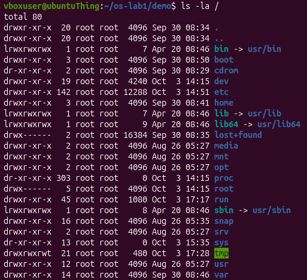

I found it interesting how Linux has the filesystem as one unified tree, unlike Windows which uses letter drives e.g. `(C:)`, `(D:)`.

### Observations

1. Who owns the files you just created, and which group? 

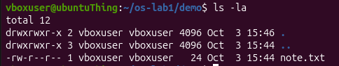

The file `note.txt` is owned by the user that created it, `vboxuser`, which is also the group assigned to it. The group is named the same as the user because by default, the primary group is assigned, which is the private group created per user.

---

2. What do the ten characters at the start of `ls -l` mean for note.txt after chmod 600?

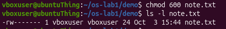

The `-rw-------` is a permission string. Here it means that the file can be read and written to only by the user owning it, while no one else can read, write, or execute the file.

---

3. Name two directories directly under / and say, in one line each, what they hold.

Linux organises files as a single unified tree. At the top there is the root `/` holding everything inside of itself.
Particularly, it holds folders like :
- `/home` - the space designed for the user;
- `/etc` - holds various configurations for the system and services.

---

## Part 2. Processes

### Findings

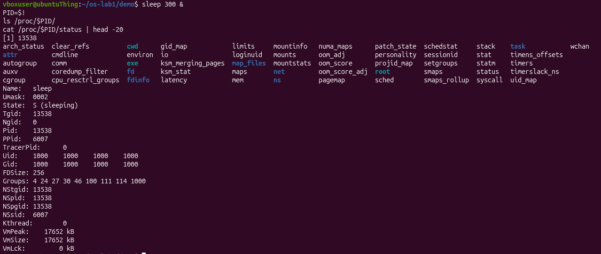

I found it fascinating how processes on Linux can be expressed through files in `/proc/`. This enlightened me on UNIX philosophy of "Everything is a file".

### Observations

1. What is the PID of process number 1, and what is it (look it up)? 

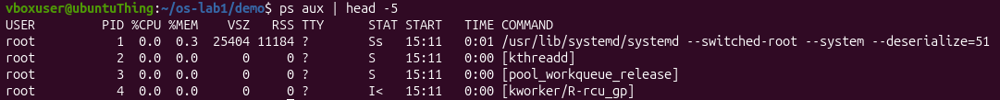
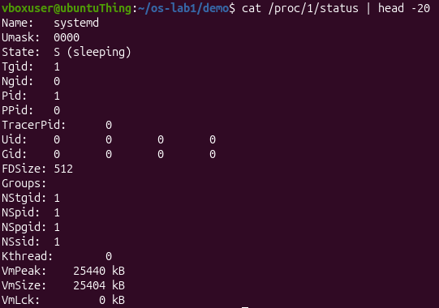

The question is ambiguous. If it is asking for the PID of the first process, it is **1**.
Otherwise, the question could mean what the process with PID = 1 **is**. In this case, the answer is `systemd`, which is the first process to be instantiated in the user mode and every next user-space process after it is its descendant. It is started by the kernel.

---

2. Roughly how many processes were running on your idle VM?

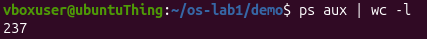

236 processes were counted(excluding one line because it is the header with info columns).

---

3. From /proc/<pid>/status, what does the "State:" line say for your sleeping process?

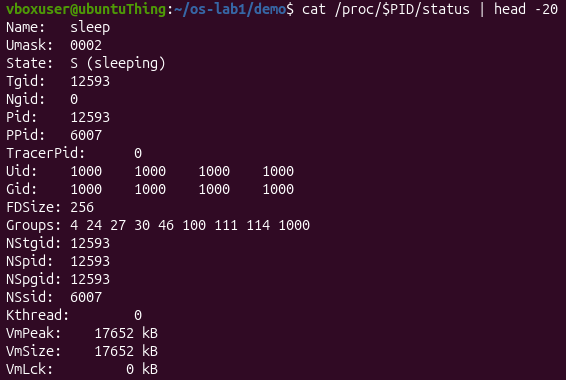

`S (sleeping)`.

---

## Part 3. Memory

### Findings

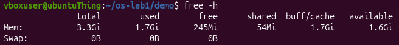

It was interesting to find out about the concept of swap memory. I did not know disk space could act as RAM in certain circumstances.

### Observations

1. How much total RAM does the VM have, and how much is free? 

According to `free -h`, the VM has **3.3GiB** in total, with **245MiB** absolutely free and **1.6GiB** available for use.

---

2. What is swap, and how much is configured? 

The swap memory is disk space the OS uses as an extension of RAM and it acts as a **very very slow** safety net for processes. There is 0B of swap memory.

---

3. How much resident memory (VmRSS) does a bare `sleep` process use, and does that surprise you?

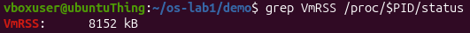

The `sleep 300` uses **8MB** of VmRSS. It does surprise me because it seems too much for a simple sleeping process, but I suppose the system counts the memory of some elements additional to `sleep`, thus not displaying the **true** memory usage.

---

## Part 4. Devices and storage

### Findings

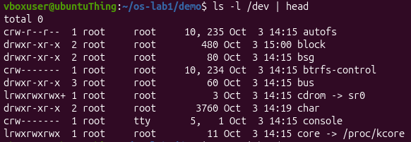

The fact that the system can communicate to devices via files in `/dev/`, solidified the idea of "everything is a file" concept. Since it allows for a standard way of interacting to devices.

### Observations

1. Which device is your root filesystem "/" mounted on?

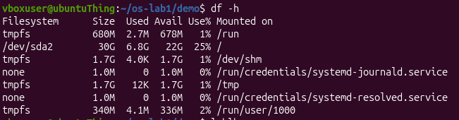

`/` is mounted on `/dev/sda2`.

---

2. Give one entry from /dev and say what real thing it stands for. 

`/dev/bus/` represents the direct access to hardware buses. It can be used for gaining access to USB via `/dev/bus/usb/`.

---

3. In one sentence: what does "everything is a file" mean, based on what you saw?

"Everything is a file" is the philosophy of the OS that expresses as files not only plain data, but also the hardware (files in `/dev/`) and even the processes (files in `/proc/`), for simplicity.

## Conclusion

The OS manages files, processes, memory and devices. More precisely, this fact can be confirmed by: managing files: **ls -l**; managing processes: **top**; managing memory: **free -h**; managing devices: **ls -l /dev | head**. In conclusion, an Operating System encapsulates tedious tasks and critical decisions in order to provide a simplified and comfortable usage of the computer by the user.