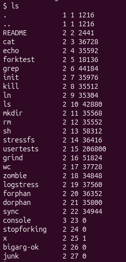
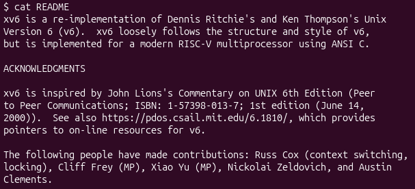
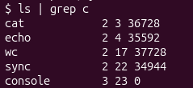
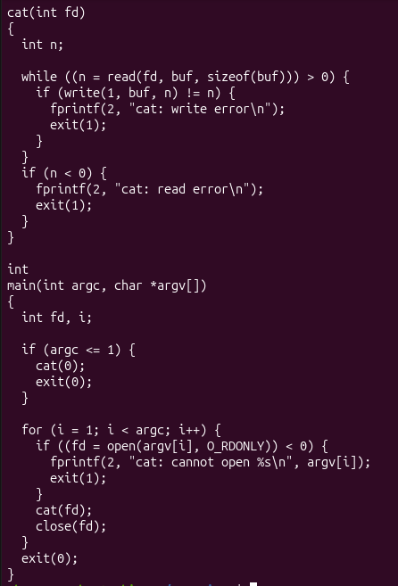
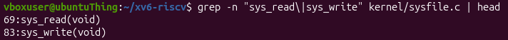

# Lab 2: build your own small OS (Track B, xv6)

## Part 2. Use xv6 as the Unix it is  

### Findings

### Observations

1. List three programs xv6 ships with.

`xv6` ships with `ls`, `cat`, `grep`.

---

2. You just used a pipe ( | ) inside xv6. Which two OS features must exist for a pipe to work?

The OS must have process management, since it creates two separate processes (`ls` and `grep`) and schedules them at the same time. It must also have file-like I/O, based on the "everything is a file" philosophy: the OS exposes the pipe as a file-like channel. `ls` writes its output into one end as if it were a file, and `grep` reads from the other end as if it were a file, so the output of one process becomes the input of the other.

---

3. In one sentence: how does the xv6 shell compare to the Linux shell from Lab 1?

`xv6` seems like a minimal version of Linux, because of its lack of several additional tools.

---

## Part 3. Read the source  

### Observations

1. Which system calls does user/cat.c use, and what does each one ask the kernel to do? 

`user/cat.c` uses:
- open() - to ask the kernel to open a file and return a file descriptor;
- read() - to ask the kernel to read bytes from a file;
- write() - to ask the kernel to write bytes to a file;
- close() - to ask the kernel to release the file descriptor;
- exit() - to ask the kernel to terminate the program.

---

2. In which kernel file, and on which line, is sys_read implemented?

`sys_read` is implemented in `kernel/sysfile.c` on line 69.

---

3. In one sentence: what is the difference between the code in kernel/ and the code in user/?

The code in `kernel/` runs in privileged mode, while code in `user/` runs in user-mode.