# Lab 3: The Command Line: Shell, Pipes and Text Filters

## Part 1. Move fast,find help

### Observations

**1. Which of cd, ls, echo are built-ins, and why MUST cd be one?**

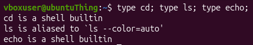

- `cd` is a shell builtin;
- `ls` is an external command;
- `echo` is a shell builtin.

`cd` **must** be a shell built-in command, because it changes shell's directory.

---

**2.  How many directories are in your PATH, and in which one is ls?**

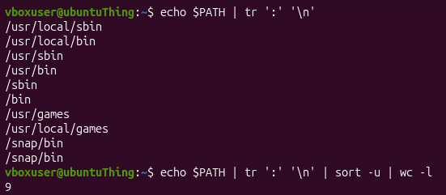

There are 9 directories in `$PATH`.

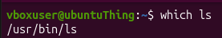

`ls` is in `/usr/bin/ls`.

---

**3. What exit code does a command that is not found return?**

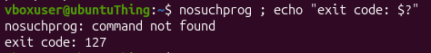

`127`.

---

**4. Which option of ls sorts by modification time? (find it in man ls)**

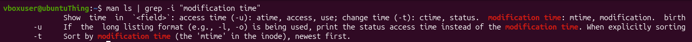

`-t`.

---

## Part 2. Move fast,find help

### Observations

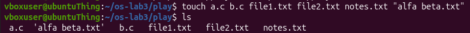

**1. For each line: your prediction, the real output, and one sentence if they differ.**

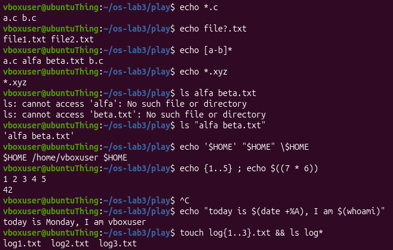

| Command           | My Predictions            | Real output           | Explanation (if different) |
|----------         |----------                 |----------             |----------|
| `echo *.c`        | `a.c b.c`                 | `a.c b.c`             |----------|
| `echo file?.txt`  | `file1.txt file2.txt`     | `file1.txt file2.txt` |----------|
| `echo [a-b]*`     | `a.c  'alfa beta.txt'   b.c `     | `a.c alfa beta.txt b.c` | I did not expect it to strip quotes|
| `echo *.xyz`      | Nothing     | `*.xyz` | I forgot it prints the name as-is if it's not found|
| `ls alfa beta.txt`  | An error | `ls: cannot access 'alfa': No such file or directory` `ls: cannot access 'beta.txt': No such file or directory` | I did not know the exact error message but predicted the general output|
| `ls "alfa beta.txt"`      | `alfa beta.txt`     | `'alfa beta.txt'` | It added quotes|
| `ls "alfa beta.txt"`      | `$HOME /home/vboxuser $HOME`     | `$HOME /home/vboxuser $HOME` |----------|
| `echo {1..5} ; echo $((7 * 6))`      | `1 2 3 4 5`   `42`     | `1 2 3 4 5`   `42` |----------|
| `echo "today is $(date +%A), I am $(whoami)"`      | `today is Monday, I am vboxuser`     | `today is Monday, I am vboxuser` |----------|
| `touch log{1..3}.txt && ls log*`      | `log1.txt  log2.txt  log3.txt`     | `log1.txt  log2.txt  log3.txt` |----------|

---

**2.  `echo` knows nothing about files, yet `echo *.c` printed file names. Who produced them?**

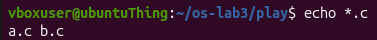

It's the shell, it does globbing.

---

**3. Why did `ls alfa beta.txt` fail? Give two different ways to fix it.**

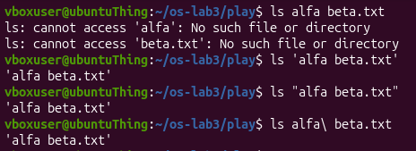

It failed because the name of the file was given by spaces and thus was treated as two arguments, `alfa` and `beta.txt`.

To fix it, use double quotes(`ls "alfa beta.txt"`) or single quotes(`ls 'alfa beta.txt'`) or with backslash(`ls alfa\ beta.txt`).

---

**4. What is the difference between single and double quotes?**

- 'single quotes' stop everything: the text is taken literally.
- "double quotes" keep spaces but still expand `$variables`.

---

## Part 3. Redirection, chaining and jobs

### Observations

**1. Which file got the error message, and which got the listing?**

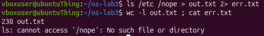

`out.txt` got the listing and `err.txt` got the error message.

---

**2. What is the difference between `> all.txt 2>&1` and `2>&1 > all.txt` ? Try both and explain why the result differs.**

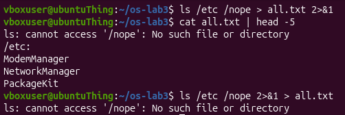

In the case of `> all.txt 2>&1`, the `file descriptor 1` is pointing to `all.txt`, while in the case of `2>&1 > all.txt`, the `file descriptor 1` points to the terminal.

---

**3. Why does `wc -l < access.log` print only a number, while `wc -l access.log` also prints the file name?**

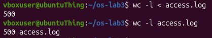

In the case of `wc -l < access.log`, the shell opens `access.log` and passes its content to `stdin` of `wc`, `wc` has no filename argument. While in the case of `wc -l access.log`, `wc` opens `access.log` itself, knows the name and prints both.

---

**4.  Explain each operator in one sentence: ; && || .**

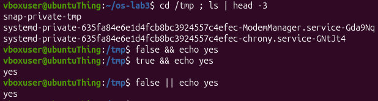

- `;` run the next one no matter what.
- `&&` run the next one only if this one succeeded (exit code 0).
- `||` run the next one only if this one failed.

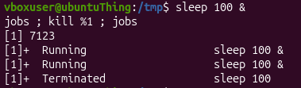

---

## Part 4. Answer questions with one-liners

### Observations

**1. How many requests failed?**

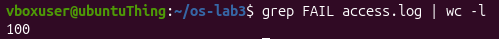

Command used: `grep FAIL access.log | wc -l`

`grep FAIL access.log | wc -l`.

---

**2. How many different pages were requested, and which?**

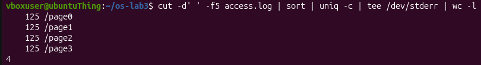

Command used: `cut -d' ' -f5 access.log | sort | uniq -c | sort -rn | tee /dev/stderr | wc -l`

There are 4 distinct pages: `/page0`, `/page1`, `/page2`, `/page3`.

---

**3. How many requests did each page get?**

Command used: `cut -d' ' -f5 access.log | sort | uniq -c | sort -rn | tee /dev/stderr | wc -l`

Each page got 125 requests.

---

**4. Which user or users have the most failed requests, and how many?**

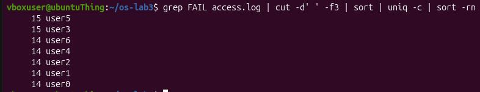

Command used: `grep FAIL access.log | cut -d' ' -f3 | sort | uniq -c | sort -rn`

`user5` and `user3` have the most failed requests, totalling 15.

---

**5. How many requests did user3 make, and how many of them failed?**

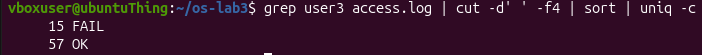

Command used: `grep user3 access.log | cut -d' ' -f4 | sort | uniq -c`

- `FAIL`: 15;
- `OK`: 57.

---

**6. Print the last 3 failed requests, showing only time and user.**

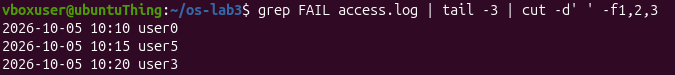

Command used: `grep FAIL access.log | tail -3 | cut -d' ' -f1,2,3`

---

**7. Which login shells appear in /etc/passwd, and how many accounts use each? (field 7, separator :)**

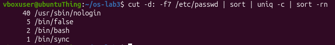

Command used: `cut -d: -f7 /etc/passwd | sort | uniq -c | sort -rn`

---

**8. PREDICT, then explain: why do `ls /etc | wc -l` and `ls -l /etc | wc -l` differ by exactly one?**

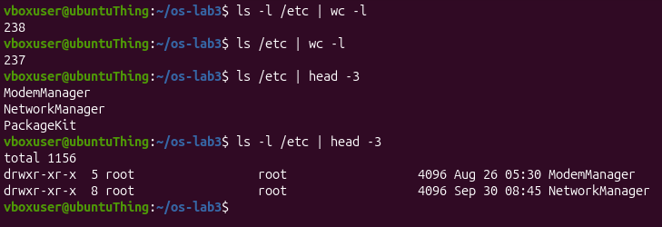

The `ls -l /etc` also prints one line for `total`.

---

## Part 5. Your first script

### Observations

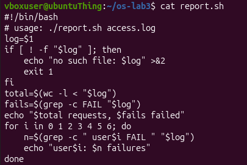
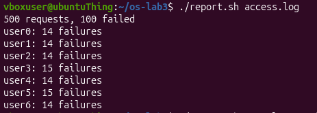
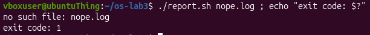