# Lab 4: The xv6 Shellfrom the Outside

## Part 1. Fix sleep for the current xv6

### Observations

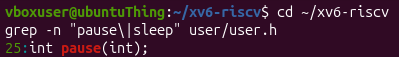

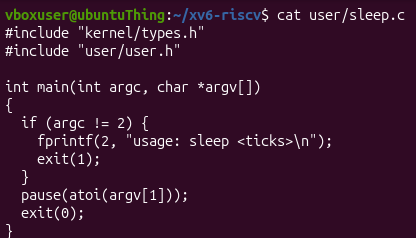

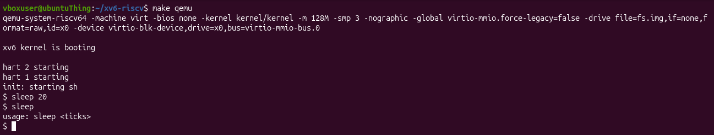

## Part 2. bash versus the xv6 shel

### Observations

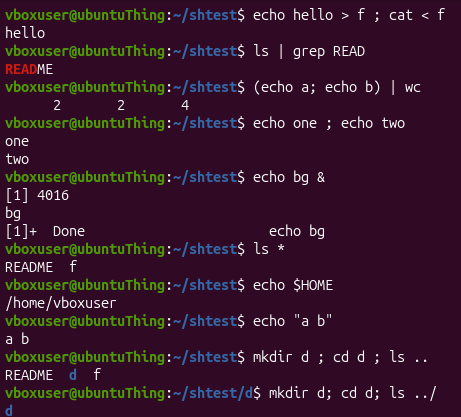

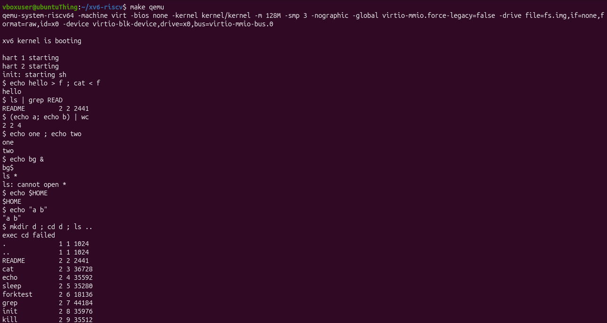

| Command | Tests | bash | xv6 |
|---|---|---|---|
| echo hello > f ; cat < f | redirection |  `hello` |  `hello` |
| ls \| grep READ | pipe |  `README` |  `README 2 2 2441` |
| (echo a; echo b) \| wc | grouping, list |  `2 2 4` |  `2 2 4` |
| echo one ; echo two | sequence | `one`<br>`two` | `one`<br>`two` |
| echo bg & | background |  runs, then `[1]+ Done` |  runs, no job message (prompt prints before `bg`) |
| ls * | globbing |  `README f` |  `ls: cannot open *` |
| echo $HOME | variables |  `/home/vboxuser` |  prints `$HOME` literally |
| echo "a b" | quotes |  prints `a b` |  prints `"a b"` with the quotes |
| mkdir d ; cd d ; ls .. | PATH |  `README d f` |  `exec cd failed` |
| arrow up, Tab, Ctrl+R | history, completion |  |  |

---


**1. List the features both shells have, and the ones only bash has.**

**Similarities:**
- Both have redirections (`<`);
- Both support pipes (`|`);
- Both have `grep`;
- Both have `;` `&` and `( )`.

**Differences:**
- xv6 lacks globbing;
- xv6 lacks variables;
- xv6 lacks quotes;
- xv6 lacks history;
- xv6 lacks Tab;
- xv6 lacks PATH;

---

**2. In xv6, ls stops working after cd d. Why? Find a way to run ls from inside d anyway.**

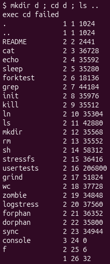

In xv6, the shell finds programs by exec’ing the name as a path relative to the current directory. To still execute, `/ls` can be used.

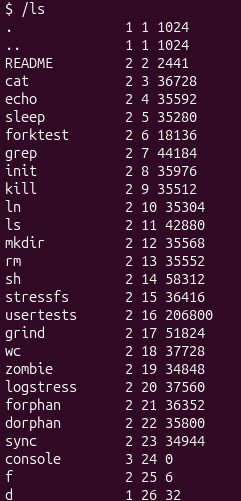

---

**3. Which missing feature would you miss most in daily work, and which would be easiest to add?**

I would miss `history`. The easiest feature to add is `quotes`.

---

## Part 3. Who expands \*? A program that prints its arg

### Observations

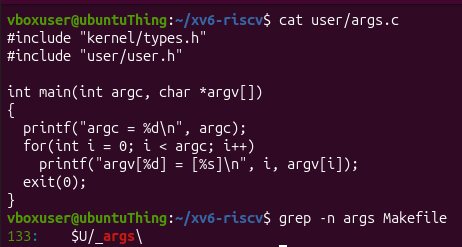

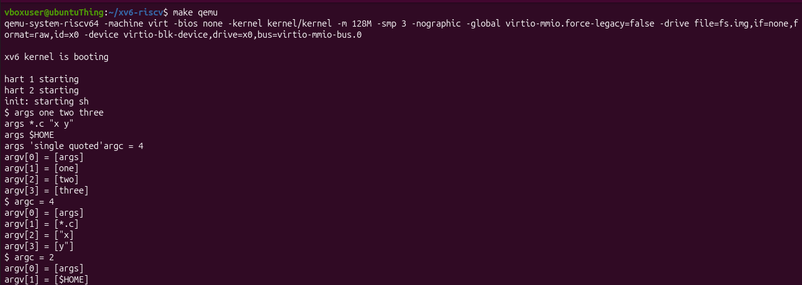

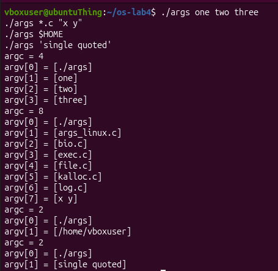

**1. Paste both outputs for args \*.c "x y" . How many arguments did each program receive?**

`Bash`: 8 arguments.
```
argc = 8
argv[0] = [./args]
argv[1] = [args_linux.c]
argv[2] = [bio.c]
argv[3] = [exec.c]
argv[4] = [file.c]
argv[5] = [kalloc.c]
argv[6] = [log.c]
argv[7] = [x y]
```

`xv6`: 4 arguments.
```
$ argc = 4
argv[0] = [args]
argv[1] = [*.c]
argv[2] = ["x]
argv[3] = [y"]
```

---

**2. So who turns \*.c into file names and removes the quotes: the program, the kernel, or the shell?**

The `shell`.

---

**3. What happened to the extra spaces in one two three ?**

They were ignored.

---

## Part 4. Read the shell

### Observations

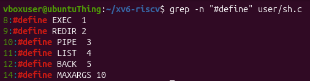
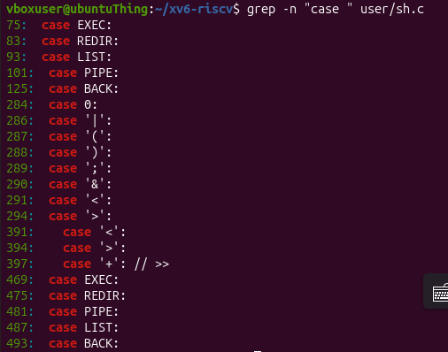
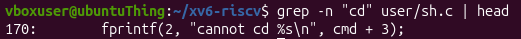

**1. Name the five kinds of command the xv6 shell knows and the character that produces each.**

| Type | Meaning | Produced by |
|---|---|---|
| `EXEC` | a plain command with its arguments | just words, e.g. `echo hi` (no special character) |
| `REDIR` | a command with redirected input or output | `<`, `>`, `>>` |
| `PIPE` | left command's output feeds the right | `\|` |
| `LIST` | run one command, then the next | `;` |
| `BACK` | run in the background | `&` |

---

**2. Where is cd handled, and why is it not run as a separate program?**

The only match for cd is at line 170, in main(). The shell checks if the input line starts with cd and calls chdir() itself, before it forks. A failure prints cannot cd ....

It can’t be a separate program because a working directory belongs to a process. When the shell runs a command, it forks a child and the child execs the program. If cd were an external program, it would change its own directory and then exit, leaving the shell’s directory unchanged. So cd has to be a built-in that runs in the shell process.

---

**3. Search sh.c for any code that handles `*`or `$`. What does that explain about Part 2?**

There is none. The tokenizer’s special-character cases (lines 284-294) cover only `|`, `(`, `)`, `;`, `&`, `<`, `>` (plus `>>` at 397). Nothing handles `*`, `$`, or `"`.


---