# Lab 5: The File System with Your Own Hands

## Part 1. The tree and the file types

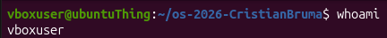

### Observations

**1. For each path in the second line, write its type from the first letter of `ls -l`.**

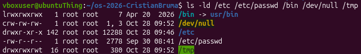

| String | Letter | File type |
|---|---|---|
|`lrwxrwxrwx`| `l` | symbolic link|
|`crw-rw-rw-`| `c` | character device|
|`drwxr-xr-x`| `d` | directory|
|`-rw-r--r--`| `-` | regular file|
|`drwxrwxrwt`| `d` | directory|

---

**2. What is `/bin` on your system: a directory or a link, and to where?**

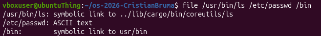

`/bin:` symbolic link to `usr/bin`

---

**3. Find one character device and one block device in `/dev`.**

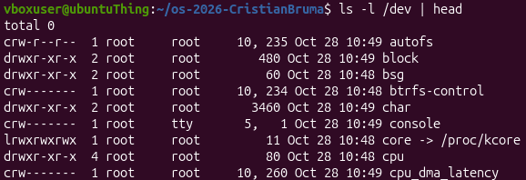

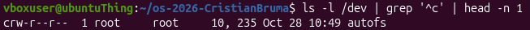

`crw-r--r--`  1 root     root     10, 235 Oct 28 10:49 `autofs`

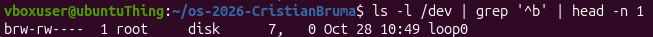

`brw-rw----`  1 root     disk      7,   0 Oct 28 10:49 `loop0`

---

**4. Which is bigger on your laptop, `/var/log` or `/usr`, and by roughly how much?**

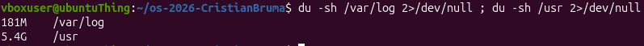

`/usr` is bigger by roughly `5.3GB` than `/var/log`.

## Part 2. Inodes and links

### Observations

**1. Which number in stat is the inode, and which tells how many names the file has?**

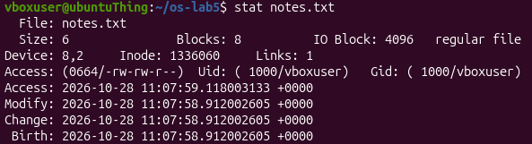

`Inode: 1336060` is the inode number.
`Links: 1` tells how many names the files has.

The inode number can also be seen in the `ls -li notes.txt` command.

---

**2. After `rm notes.txt`, why could you still read `hard.txt`? What does `rm` really remove?**

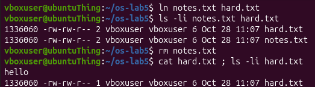

`hard.txt` could still be read because `rm notes.txt` only removed one name of the inode. The `inode 1336060` wasn't removed.

---

**3. Why did `cat soft.txt` fail at the end, although `soft.txt` still exists? How big is `soft.txt` and why exactly that size?**

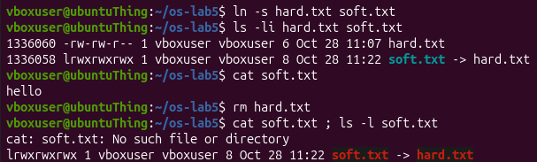

`cat soft.txt` failed because its target, `hard.txt`, was removed, so it pointed to a non-existing path. 
A symlink’s size is the length of the path string it stores. The target is `hard.txt`, so the size is `8 bytes`.

---

**4. A new directory has 2 links, and 4 after you create two subdirectories. Explain where each link comes from.**

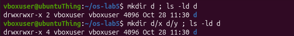

A directory’s link count is the number of entries pointing to its inode.
`Empty d = 2`: its name `d` in the parent, plus its own `.` entry.
After `d/x` and `d/y` `= 4`: each subdirectory’s `..` points back to `d`, adding 1 apiece.

---

**5. Why does a 2-byte file use `4.0K`, and a `1 GB` file use 0?**

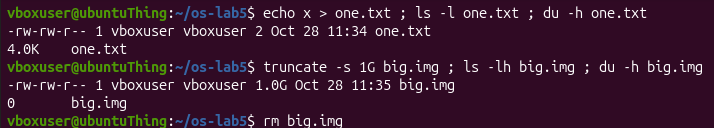

`one.txt` occupies `4KB` because it's the minimum block size in the filesystem that was allocated for the file.
For `big.img` the inode records the size, but blocks of zeros are never written.

---

## Part 3. Permissions

### Observations

**1. Write `600`, `644`, `755` and `700` as `rwx` strings, and give one real use for each.**

| Number | Means       | Typical for                              |
|--------|-------------|------------------------------------------|
| 600    | `rw- --- ---` | private files: keys, passwords           |
| 644    | `rw- r-- r--` | normal files: you edit, everyone reads   |
| 700    | `rwx --- ---` | private directories, ~/.ssh              |
| 755    | `rwx r-x r-x` | programs and directories                 |

---

**2. With `chmod 000` you own the file but cannot read it. Why does ownership not help?**

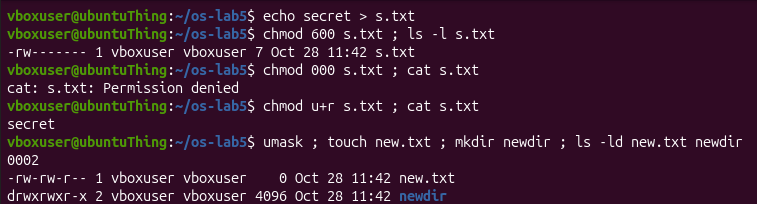

Ownership does not override permissions. With `chmod 000`, the owner cannot read, write or execute.

---

**3. What is your `umask`, and how does it explain the permissions of `new.txt` and `newdir`?**

`umask` is `0002`.
Files start at `666`, so `666 - 002 = 664` → `rw-rw-r--` (`new.txt`).
Directories start at `777`, so `777 - 002 = 775` → `rwxrwxr-x` (`newdir`).
Only the “other write” bit was removed in both cases.

---

**4. Explain the box experiment: what does `r` allow on a directory, and what does `x` allow?**

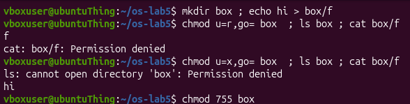

`r` on a directory: you may list the names in the table.  
`x` on a directory: you may pass through it to reach an inode, if you know the name.

---

**5. What do the `s` in `/usr/bin/passwd` and the `t` in `/tmp` mean, and why does passwd need the `s`?**

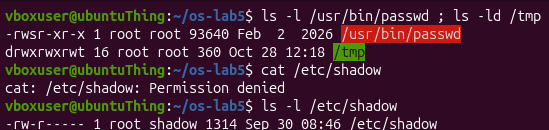

`s` instead of `x` (setuid): the program runs with its OWNER's rights. `passwd` runs as root so it can write `/etc/shadow` for you.  
`t` at the end (sticky): in `/tmp` everyone may write, but only the owner may delete their own files.

---

## Part 4. Disks and the kernel as files 

### Observations

**1. Draw your disk: disk name, partitions, which one is mounted at `/` and with what file system type.**

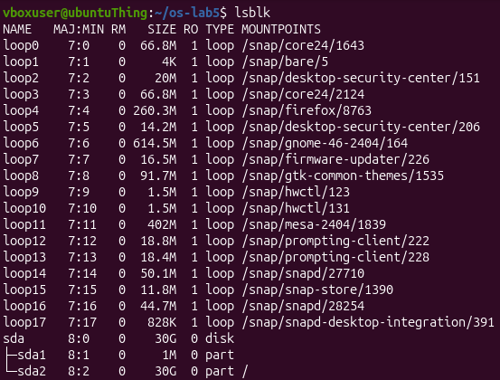

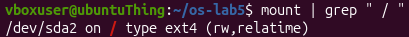

Disk is named `sda`, with 2 partitions, `sda1` and `sda2`. `/dev/sda2` is mounted at `/` with filesystem type `ext4`.

---

**2. How full is your root file system?**

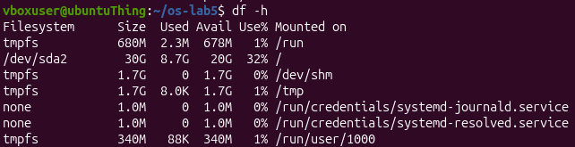

The root filesyste, `/dev/sda2` mounted at `/`, has `8.7G` used out of `30G`.

---

**3. How many CPU cores and how much RAM does your laptop have, according to `/proc`?**

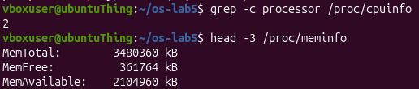

The virtual machine has `2` CPU cores.
The virtual machine also has about `3.4GB` of RAM.

---

**4. `/proc/self/status` showed the name of a program. Which one, and why that one?**

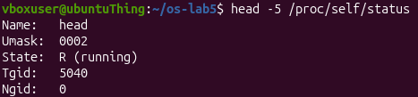

It shows `head`, because `/proc/self` always refers to the process that is reading it, and the process opening the file here is `head`.

---

## Conclusion

During this work the main elements of a Linux file system were examined with ordinary commands. The types of files were read from the first letter of the output of ls -l, and it was found that /bin is a symbolic link to usr/bin, that autofs is a character device and loop0 is a block device, and that /usr is about 5.3 GB bigger than /var/log.  
The experiments with inodes showed that a name is separate from the file: rm removes a name and decreases the link count, so a hard link keeps the data alive, while a symbolic link only stores a path and breaks when the target disappears. The link count of a directory was explained by the entry in the parent, the . entry and the .. entries of the subdirectories, and the difference between the apparent size and the used space was demonstrated with a small file and a sparse file.  
In the part about permissions, the numeric and symbolic modes were matched, the default modes of new files and directories were explained by umask 0002, and it was confirmed that ownership does not override the mode bits. The meaning of r and x on directories, of the setuid bit of passwd and of the sticky bit of /tmp was observed in practice.  
Finally, the virtual machine was found to have a disk sda with the root file system /dev/sda2 of type ext4 (8.7 GB used out of 30 GB), 2 CPU cores and about 3.4 GB of RAM, and the /proc pseudo file system was used to read this information directly from the kernel. All objectives of the practical work were achieved.