# Lab 6: Inside the xv6 File System

## Part 1. Read what xv6 shows you

### Observations

**1. What do types 1, 2 and 3 mean (`kernel/stat.h`)?**

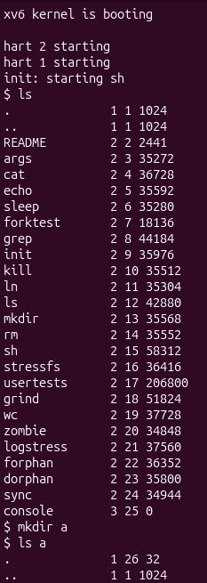

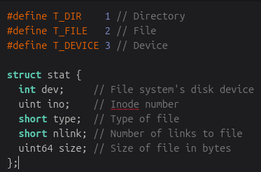

- `1` - `Directory`;
- `2` - `File`;
- `3` - `Device`.

---

**2. Which inode number does the root directory have, and why are `.` and `..` the same there?**

The inode of `root` is `1`. Both `.` and `..` have the same indoe because the refer to the same directory.

---

**3. An empty directory `a` has size `32`. A directory entry has a fixed size. How big is one entry, and which two entries does `a` contain?**

One entry is `16 bytes`, and `a` contains 2 directories: `.` and `..` .

---

## Part 2. Write `mystat`

### Observations

**1. Paste the outputs after `ln` and after `rm`. What changed and what did not?**

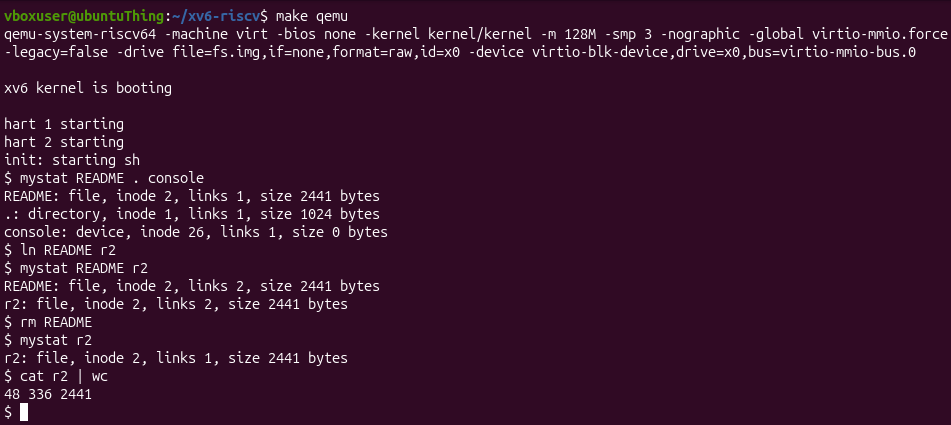

Outputs:
```
$ mystat README . console
README: file, inode 2, links 1, size 2441 bytes
.: directory, inode 1, links 1, size 1024 bytes
console: device, inode 26, links 1, size 0 bytes
$ ln README r2
$ mystat README r2
README: file, inode 2, links 2, size 2441 bytes
r2: file, inode 2, links 2, size 2441 bytes
$ rm README
$ mystat r2
r2: file, inode 2, links 1, size 2441 bytes
$ cat r2 | wc
48 336 2441
```

---

**2. Find the line in `kernel/sysfile.c` (`sys_unlink`) that decrements the link count. When are the data blocks freed?**

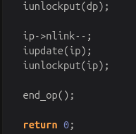

The link count decrementation code:
```
ip->nlink--;
iupdate(ip);
iunlockput(ip);
```

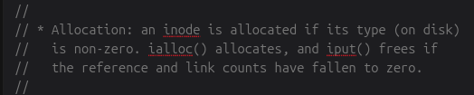

According to the comments in `kernel/fs.c`, there is `iput()` which frees the data once the reference and link counts are zero.

---

**3. xv6 has no symbolic links and no permissions. Look at `struct dinode` in `kernel/fs.h`: which fields does an `xv6` inode have?**

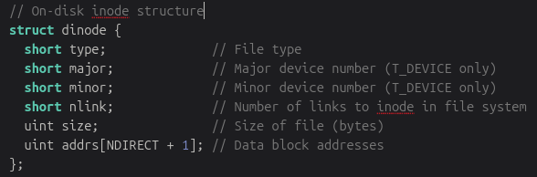

`xv6` inode has:
```
  short type;              // File type
  short major;             // Major device number (T_DEVICE only)
  short minor;             // Minor device number (T_DEVICE only)
  short nlink;             // Number of links to inode in file system
  uint size;               // Size of file (bytes)
  uint addrs[NDIRECT + 1]; // Data block addresses
```

---

## Part 3. Measure the limits

### Observations

**1. What does `ls` show for `averyveryverylongname`, and which constant explains it?**

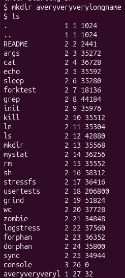

It shows:
```
averyveryveryl 1 27 32
```
Meaning it is a directory (type `1`), has `27` as inode number and occupies `32 bytes` of space.

---

**2. Compute the largest file xv6 can hold: 12 direct blocks plus one indirect block that holds block numbers of 4 bytes each, blocks of `BSIZE` bytes. Show the calculation.**

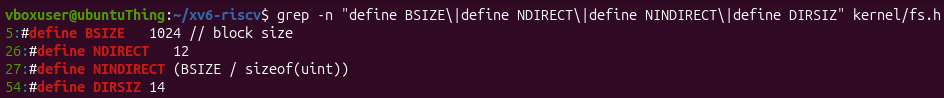

```
NINDIRECT = BSIZE / sizeof(uint) = 1024 / 4 = 256

# one file can hold at most NDIRECT direct blocks + NINDIRECT indirect blocks each being BSIZE in size, therefore the max file size:

MAX_FILE_SIZE = (NDIRECT + NINDIRECT) * BSIZE = (256 + 12) * 1024 = (268) * 1024 = 274432 = 268 KB

```

In theory, the size must be slightly greater, since the memory consumed by the `inode` and the indirect block's own size could also be included.

---

**3. From the `nmeta` line: how many blocks does the whole disk have, and how many are for the log, the inodes, and the data?**

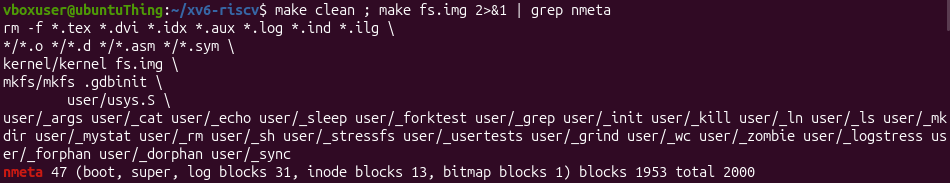

The disk has `total 2000` blocks.
There are `31` blocks for the log, `13` for the inodes and `1953` for the data.


---

## Part 4. Write `find`

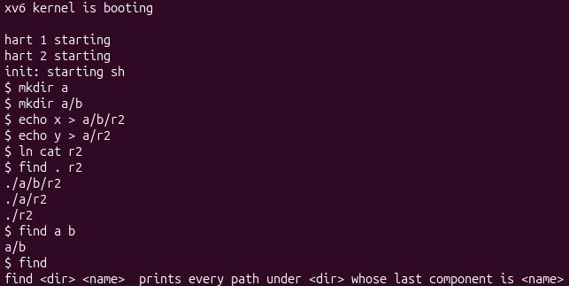

### Stretch (optional)

**Add a third argument: `find . r2 -n` prints, next to each path, its inode number. Which of the three `r2` files are the same file as `cat`?**

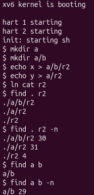

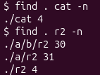

`cat` and `r2` have the same `inode` so they represent the same file.

---

## Conclusion

In this work the xv6 file system was studied through the information shown by the system, two user programs were written, and the limits of the file system were measured. The main findings are the following:
-	the types 1, 2 and 3 correspond to a directory, a regular file and a device, the root directory has inode 1, and a directory entry occupies 16 bytes;
-	a hard link is a second name of the same inode, and rm only decrements the link count, so the data remain available until the last link and the last reference disappear;
-	the xv6 inode contains only the type, the device numbers, the link count, the size and the block addresses, without permissions and without the file name;
-	names are limited to DIRSIZ (14) characters, and the maximum file size is 268 blocks, which equals 274432 bytes with BSIZE equal to 1024;
-	the disk image has 2000 blocks, of which 31 belong to the log, 13 to the inodes and 1953 to the data;
-	the program find traverses the tree recursively and, with the -n argument, shows that cat and one of the r2 files share an inode.
The programs mystat and find were implemented and tested successfully, and the exercises confirmed that the main concepts of ext4-like file systems can be observed directly in a compact implementation.