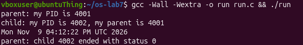
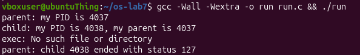
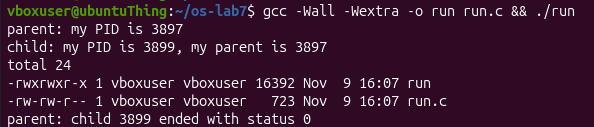
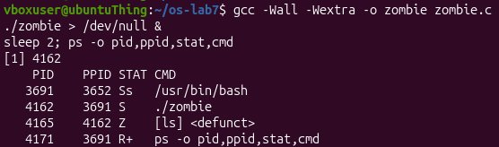
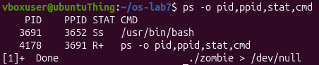
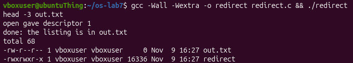
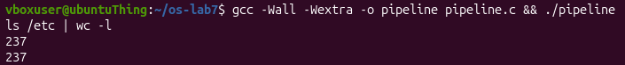
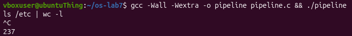

# Lab 7: Three Small Programs: Processes, Redirection, a Pipe

## Part 1. fork + exec + wait

### Observations

**1. The line `perror("exec")` is in the child, right after `execlp`. Why is it printed only with nosuchprog?**

On success `exec` never returns. Any line after it runs only if `exec` failed.

---

**2. Which number does the child print as "my parent", and whose PID is it?**

The child's parent number is the PID of the initial process that create the said child.

---

**3. What status does the parent see with ls, and what status with nosuchprog?**

  

With `ls` it gets the status `0`, which means the child successfully ended with no problems.
While with `nosuchprog`, the child ended with status `127`.

---

## Part 2. A zombie, on purpose

### Observations

**1. Which letter does ls have in the STAT column, and what does it mean?**

`ls` has the letter `Z`, meaning it is a zombie process.

---

**2. After 20 seconds, is the `[ls] <defunct>` line still there? Which line of `zombie.c` made it disappear?**

`ls` is not in the process table after 20 seconds. That is because after `sleep(20)` (waiting for 20 seconds), the parent waited for the child with line `waitpid(pid, &status, 0); `.

---

## Part 3. Redirection: `ls -l > out.txt`

### Observations

**1. Which number did `open` give, and why exactly that one?**

`open` gave the file descriptor `1`, because it was the smallest file descriptor available.

---

**2. `ls` was not changed at all. Why does its listing not appear on the screen?**

It does not appear on screen, because its file descriptor was redirected to `out.txt`.

---

**3. To redirect the errors instead (like 2> err.txt), which descriptor would you close before open?**

`2`.

---

## Part 4. A pipe: `ls /etc | wc -l`

### Observations

**1. Did `./pipeline` and `ls /etc | wc -l` give the same number?**

Yes.

---

**2. After the change, which of the two children never ends, ls or wc?**

`wc` never terminates.

---

**3. Why, in one sentence: what is wc waiting for?**

`wc` is waiting for `EOF` on the pipe, which the kernel delivers only once every open descriptor pointing at the pipe's write end, in all processes, has been closed.