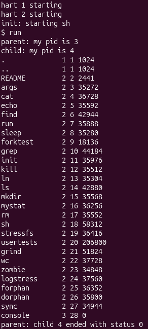
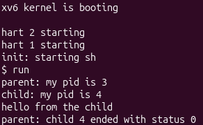
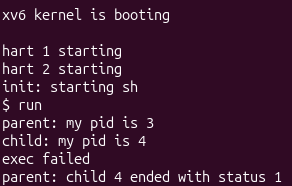
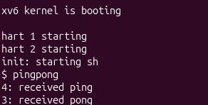

# Lab Report: The Same Calls, Inside Your Own OS

## Part 1. run, inside xv6

### Observations

**1. Write the three calls that `run.c` uses in xv6 and the three calls `run.c` used on Linux in Lab 7. What is the same?**

xv6 (Lab 8): `fork()`, `exec("echo", args)`, `wait(&status)`

Linux (Lab 7): `fork()`, `execlp("ls", "ls", "-l", NULL)`, `waitpid(pid, &status, 0)`

What is the same: the three steps and the roles of the calls are identical.

---

**2. Who prints "hello from the child": the code of `run`, or `echo`?**

`echo` prints it, not the code of `run`.

---

**3. Why is the status 1 here and 127 on Linux? (Look at the exit line after exec in both programs.)**

Because the two programs call exit with different numbers after a failed exec, and the parent just reports whatever number the child gave.

---

## Part 2. pingpong

### Observations

**1. Why do you need TWO pipes, and not one for both directions?**

A pipe is one buffer with one reading end and one writing end, and it is first-in, first-out. It has no notion of “who wrote this byte”, so any process holding the read end can take any byte out of it.

If parent and child shared a single pipe, the parent would write the ping and then immediately call `read` on the same pipe.

---

**2. Nothing in your code says "wait until the child has replied". Which call makes the parent wait?**

The parent’s `read(c2p[0], &b, 1)`.

---
